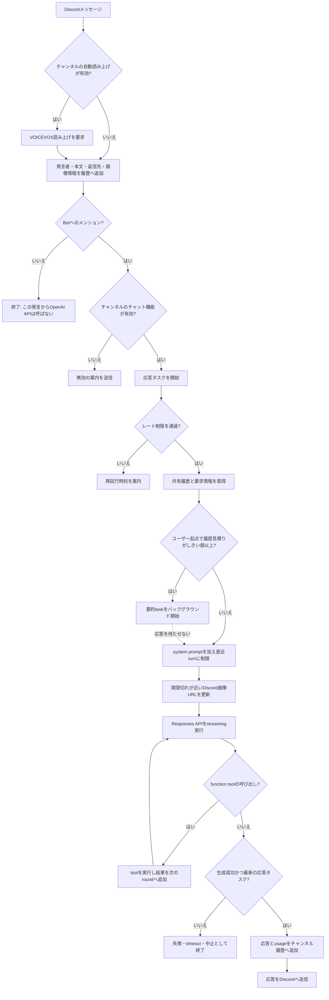

# AIチャットの処理フロー

Discordで受け取った発言が、履歴・モデル応答・履歴圧縮へ進む順序を示します。期限の一覧は[タイムアウト方針](timeouts.md)、圧縮の詳細は[アーキテクチャ](architecture.md#会話履歴のコンテキスト圧縮)を参照してください。

## Discordメッセージ

メンションの有無やチャット機能の有効状態にかかわらず、受信したメッセージは先にチャンネル履歴へ追加されます。読み上げが有効なら、その発言をVOICEVOXにも渡します。メンションがない場合とチャット機能が無効な場合、その発言を起点とした会話用のOpenAI APIは呼びません。登録済みcronなど別の起点は独立して動きます。

## 応答タスク

1. メンション時は、同じチャンネルで動いている前の応答タスクを中止して新しいタスクを始めます。呼び出しユーザーのレート制限を確認し、拒否された場合は応答APIも圧縮APIも呼びません。
2. レート制限を通過したユーザー起点要求では、共有履歴が `CONTEXT_COMPACTION_TOKEN_LIMIT` 以上かを確認し、超えていれば圧縮を別taskで開始します。通常応答は圧縮完了を待ちません。全要求のAPI入力には、同じ推定値でしきい値の75%以内に収まる直近turnを使います。system/developer instructionと最新turnは保持し、切り捨てた履歴は共有履歴に残します。
3. 見積りは各 `InputItem` をJSON化した文字列を `tiktoken-rs` の `o200k_base` で数え、画像1件ごとに1024 tokenを予約します。GPT-6用のtokenizer対応表がないためAPI実測値との一致は保証されず、system prompt・tool定義・画像コストにも差があります。保持したsystem/developer項目と最新turnだけで予算を超える場合は、それらを優先して残します。
4. system prompt、チャンネル情報、要求種別の指示を加えてから、期限切れが近い画像URLをDiscordから更新します。元メッセージや添付が取得できない画像、および更新timeout時に未解決の画像は履歴から除いて続行します。
5. 選択中のモデルでResponses APIをstreaming実行します。function toolが呼ばれたら実行結果を次のAPI roundへ渡し、最大10 roundまで続けます。Web SearchなどのAPI toolも同じ応答処理内で扱います。
6. 生成失敗・全体timeout・新しい要求による中止では、入力メッセージは履歴に残りますが、その応答で生成中だった結果は履歴へ追加しません。圧縮は既に開始していれば独立して続きます。正常終了し、まだ最新のタスクであれば応答とtool履歴、API usageを履歴へ追加してDiscordへ送信します。送信失敗でも生成済みの履歴は戻しません。

## 圧縮の開始と反映

- 圧縮はレート制限を通過したユーザー起点要求の開始時だけ判定します。通常のメッセージ受信やメンションなしの発言からはAPIを呼ばず、cron応答も圧縮しません。
- しきい値は共有履歴全体のローカルtoken推定値です。圧縮taskは古いturnから処理し、各要約API入力を履歴JSONで最大32 KiBにします。画像は要約入力から省いて画像添付markerに置き換え、最新2 turnは共有履歴に残します。推定値がしきい値の75%以下になるまでbatchを続けます。
- 要約完了時、対象履歴が現在の履歴の先頭と一致する場合だけ、その古い部分を要約に置き換えます。要約中に追加された新しい発言は残ります。変更・clear後に対象が一致しない要約は破棄します。同じチャンネルの圧縮は同時に1つです。失敗したbatchは反映せず、既に反映済みのbatchは残します。
- 要約APIの失敗・timeoutで履歴は維持されます。アイドル中に再試行はせず、別のユーザー起点要求が実行中に来ていた場合だけ終了後に一度再判定します。詳細な分割・timeout・反映は[圧縮の詳細](architecture.md#会話履歴のコンテキスト圧縮)を参照してください。

## ほかの応答入口と履歴の寿命

| 入口 | 履歴・要求の扱い | 圧縮 |
| --- | --- | --- |
| Discordメンション | 受信メッセージをチャンネル履歴へ追加してから応答 | レート制限通過後に条件判定 |
| モーダル送信 | 入力項目をチャンネル履歴へ追加し、ユーザー応答として処理 | レート制限通過後に条件判定 |
| cron | cron promptは共有履歴へ保存せず、その応答のAPI入力だけに追加。cron用モデルとレート制限を使用 | 起動しない |

会話履歴はチャンネル単位で共有され、プロセス内にのみ保持されます。`/clear` またはチャンネル削除で消去され、プロセス再起動後には引き継がれません。system promptなどのチャンネル設定は別のJSON storeに保存されます。
